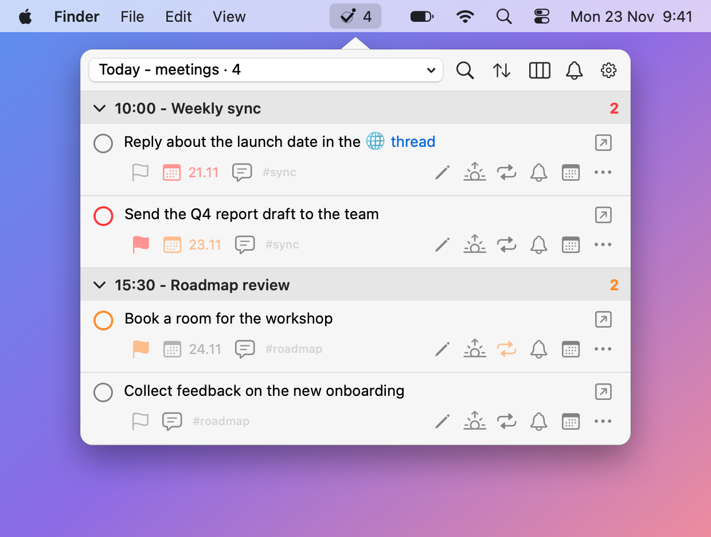
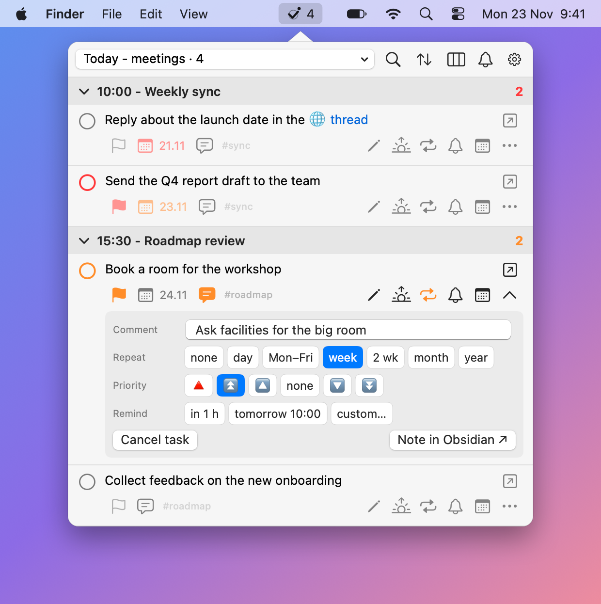
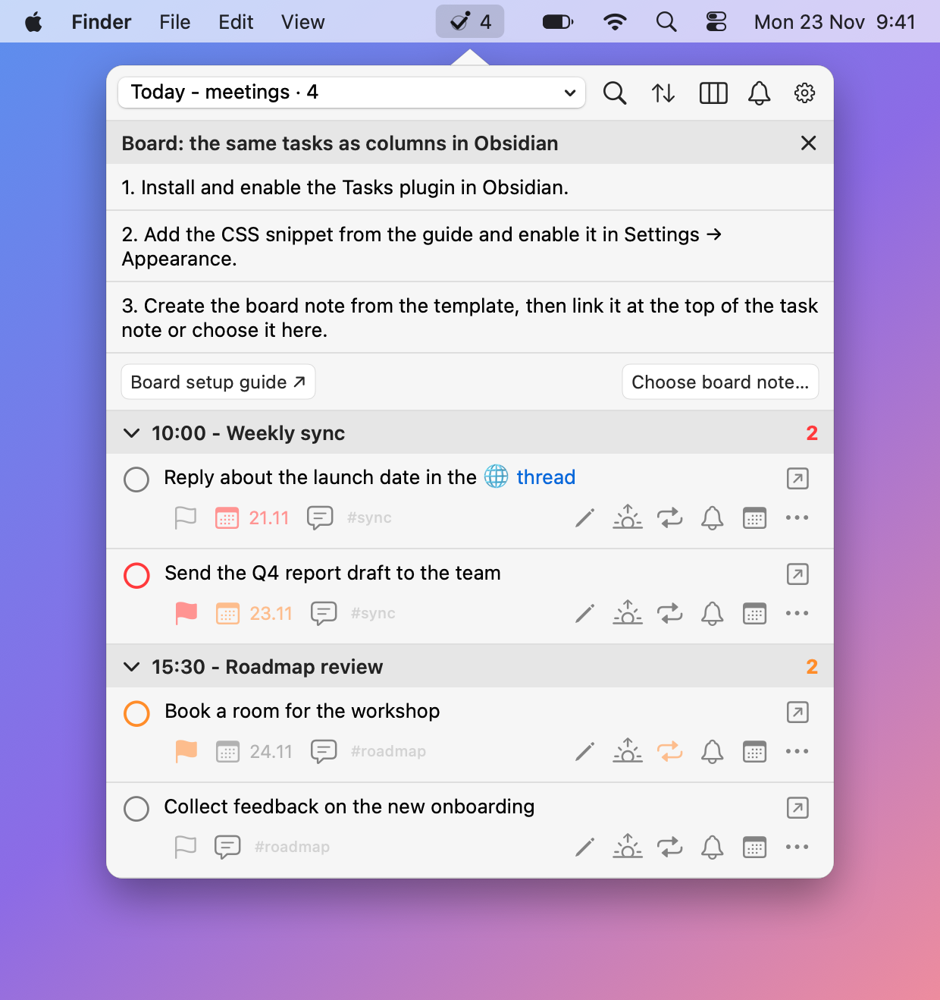

# TaskRadarBar

A macOS menu bar app that shows the tasks of one [Obsidian](https://obsidian.md) note and lets you act on them without opening Obsidian. Tasks are in the [Tasks plugin](https://publish.obsidian.md/tasks/) emoji format; every action edits the note itself.

<p>


</p>

- **Sections come from the note.** Each ```` ```tasks ```` query block in the note becomes a filter in the app. Blocks under one heading can be merged into one filter with collapsible groups.
- **Actions:** complete, cancel, move to tomorrow, pick a due date, priority, recurrence, edit text, native macOS reminders, a comment that is written into the task when it is closed.
- **Board:** a button opens the same tasks as columns by due date in Obsidian, if you keep such a [board note](docs/board.md).
- **Reminders before meetings.** A query block whose bold label starts with a time (`**15:30 - Roadmap review**`) is a meeting: the app sends one notification with that block's tasks 15 minutes, 30 minutes, 1 hour or 2 hours before it. The default for all sections is in the gear menu; the bell in the header sets another lead time, or none, for one section.
- **Search**, three sort modes, light and dark mode.
- **Interface languages:** English, German, French, Russian.
- **One line per action.** The app re-reads the note, finds the task by its exact text, replaces that single line, writes atomically and verifies. If the line changed in the meantime, nothing is written.

## Privacy and security

- No network code. The only way out is a link you click, opened by your browser or Obsidian.
- Reads and writes one file: the note you picked. Settings live in `defaults` under `com.ktar.taskradarbar`.
- Asks for notification permission only when you set the first reminder or turn on reminders before meetings. No other permissions.
- Only `http` / `https` links in task text are clickable.
- The board button and the guide link open Obsidian and your browser; the app creates no files in the vault.
- No third-party dependencies.

## Install

Download the zip from [Releases](https://github.com/daoktar/taskradarbar/releases), unzip, move `TaskRadarBar.app` to `/Applications`.

The build is ad-hoc signed and not notarized, so macOS blocks the first launch. Either build it yourself (below) or allow it in System Settings → Privacy & Security → "Open Anyway". Apple Silicon only.

Then click the menu bar icon → gear → "Choose note…".

## Build

Needs macOS 14+ and the Xcode Command Line Tools (full Xcode is not required).

```bash
./build.sh
```

This runs the self-check, builds `build/TaskRadarBar.app`, copies it to `/Applications` and restarts it. Pass a path to a note to also run the self-check against a temporary copy of that note:

```bash
./build.sh "/path/to/note.md"
```

The screenshots above are rendered by the app itself from made-up tasks, no screen capture; the menu bar and wallpaper around the popover are drawn:

```bash
.build/release/taskradarbar --screenshots docs
```

## Board

The board button in the header opens a board note in Obsidian: the same tasks as columns, made of Tasks queries and a CSS snippet. The app finds the board by the first `[[wikilink]]` at the top of the task note, or you choose the note in the gear menu. Without a board the button shows the setup steps; the snippet and a note template are in [docs/board.md](docs/board.md).



## Translations

Interface texts are in `Resources/<language>.lproj/Localizable.strings`, the standard Apple strings format. The key is the English text used in the code (`L("Choose note…")`), the value is the translation; a missing key falls back to English.

To add a language, copy `Resources/en.lproj` to `Resources/<code>.lproj` (for example `es.lproj`), translate the right-hand sides and rebuild. No code change is needed: the app lists every language it finds in Settings → Language. Keep the `%@` placeholders and the leading or trailing spaces. `./build.sh` fails if a language file misses a key or a placeholder, or if the code uses a text that is not in `en.lproj`.

To check that a translation fits the window, render the screenshots in that language:

```bash
.build/release/taskradarbar --screenshots /tmp/shots es
```

## Limits

- Supports the subset of Tasks query filters listed in `Sources/Core.swift` (`atom`). A section with an unknown filter shows an error instead of a wrong list.
- Recurrence rules: `every [N] day|week|month|year`, `every weekday`, optional `when done`. Other rules must be completed in Obsidian.
- Reminders before meetings are sent by the app itself, so the text is current at that moment. If the app is not running or the Mac is asleep then, the reminder is skipped, not sent late. The time in the label is taken as today's; an empty block sends nothing.
- The "task type" menu uses the tags `#mod/radar`, `#mod/radar/ask`, `#mod/radar/wait`; it only appears on tasks that have one of them.

## Backlog

Planned or considered, not done yet:

- global hotkey to open the window
- creating new tasks from the app
- tasks from other files of the vault, not only one note
- an Obsidian plugin version
- a reminder about all tasks of any filter at a set time of day (reminders before meetings are done)
- App Sandbox without the network entitlement
- Developer ID signing and notarization of the release builds

The full list, with known simplifications in the code and the open items of the security audit, is in [BACKLOG.md](BACKLOG.md).

## License

GPL-3.0, see [LICENSE](LICENSE).
